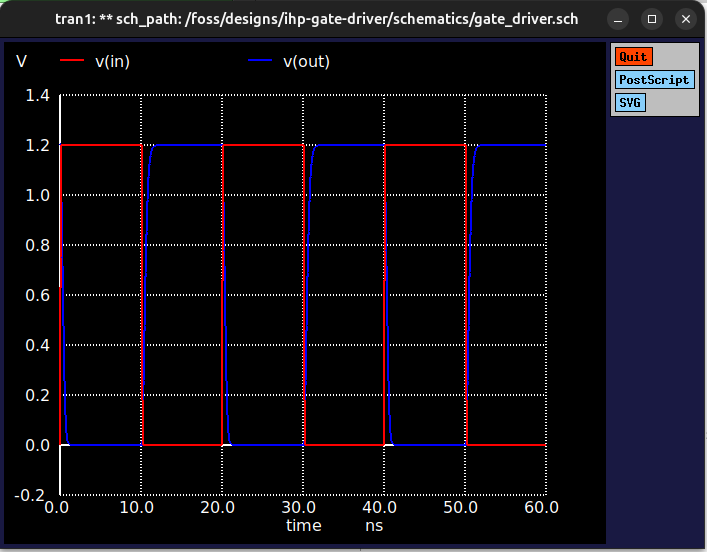
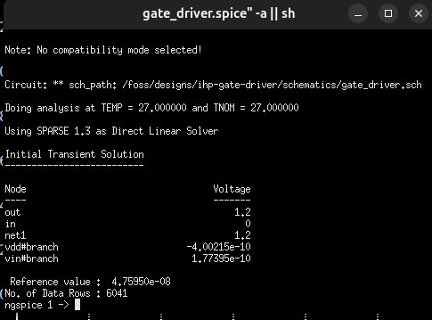

# Documentation & Simulation Results

This directory contains the performance analysis and simulation screenshots for the IHP 130nm Gate Driver.

## Transient Analysis
The transient simulation was performed using Ngspice over a 60ns window. The input is a pulse signal switching between 0V and 1.2V.

### Waveforms
The graph below illustrates the input signal `v(in)` (red) and the inverted output signal `v(out)` (blue). The curved transitions on the output clearly demonstrate the charging and discharging phases of the 1pF load capacitor by the MOS transistors.

### Ngspice Execution
The netlist was successfully compiled and simulated using the `.tran 10p 60n` SPICE command directly from the Xschem interface.

