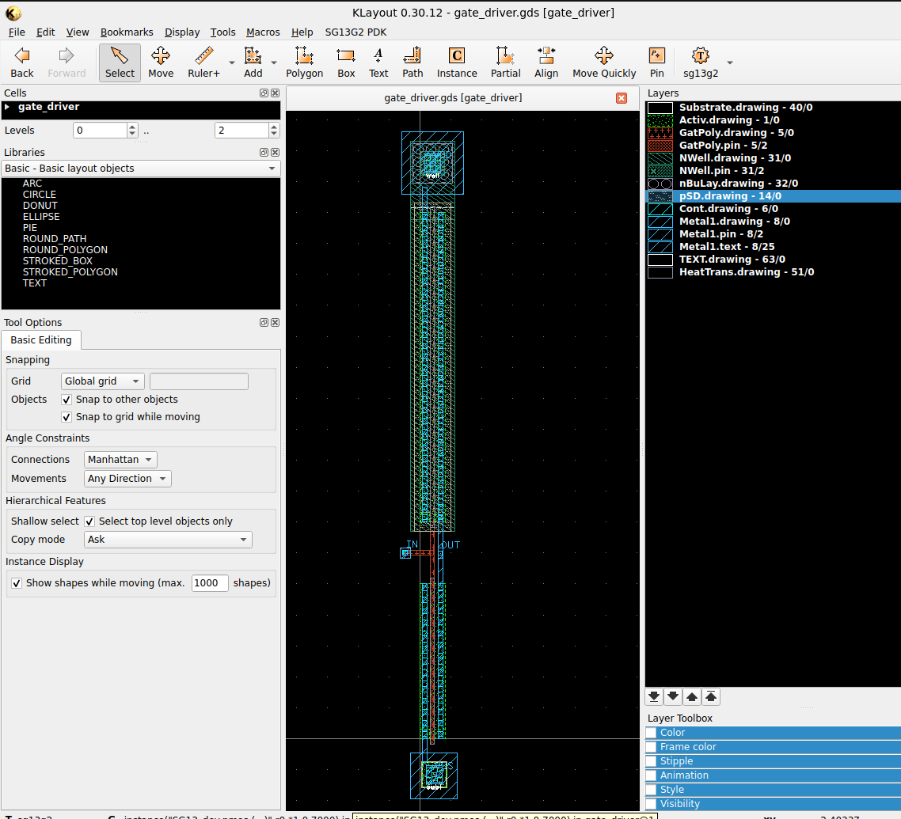

# Physical Layout & Parasitic Extraction (PEX)

This directory hosts the mask layout files, physical verification rule decks, and extracted netlists for the IHP SG13G2 gate driver cell.

---

## Files in this Directory

| File | Description |
| :--- | :--- |
| `gate_driver.gds` | Physical mask layout in GDS-II format. |
| `gate_driver_pex_magic.spice` | Raw parasitic netlist ($R+C$) extracted by Magic VLSI. |
| `gate_driver_postlayout.spice` | Subcircuit wrapper mapping the physical netlist to `xinv_pex`. |

---

## 1. Physical Layout (`gate_driver.gds`)

The layout was hand-crafted in KLayout following the standard cell conventions of the 130 nm SG13G2 BiCMOS process.

<p align="center">
  
</p>

### Layout Highlights
- **Active Area**: Sized for $W_n = 5\,\mu\text{m}$ and $W_p = 10\,\mu\text{m}$ with minimum gate length $L = 0.13\,\mu\text{m}$.
- **Guard Rings / Taps**: Integrated `ptap1` for p-substrate contact and `ntap1` for n-well contact.
- **Metal 1**: Wide supply and output buses to reduce IR drop and parasitic resistance.

---

## 2. Design Rule Check (DRC)

Physical compliance was verified with KLayout's DRC engine using the official rule deck:
```bash
klayout -b -r /foss/pdks/ihp-sg13g2/libs.tech/klayout/tech/drc/sg13g2.lydrc \
  -rd input=gate_driver.gds \
  -rd report=sg13g2_drc.lyrdb

```

**Result**: Clean run with **0 DRC violations**.

---

## 3. Layout Versus Schematic (LVS)

Electrical and pin equivalence was verified using KLayout LVS against the Xschem-generated SPICE netlist:

**Result**: All nets, ports, and MOS devices matched with **0 discrepancies**.

---

## 4. Parasitic Extraction with Magic VLSI

Because standard LVS extraction focuses on device geometry and ignores interconnect parasitics, **Magic VLSI** was used to capture full parasitic capacitance ($R+C$).

### Magic PEX Flow

```tcl
magic -dnull -noconsole -T /foss/pdks/ihp-sg13g2/libs.tech/magic/sg13g2.tech
gds read gate_driver.gds
load gate_driver
select top cell
expand
extract all
ext2spice lvs
ext2spice cthresh 0.01
ext2spice rthresh 10
ext2spice extresist on
ext2spice -o gate_driver_pex_magic.spice
quit

```

---

## 5. Post-Layout Subcircuit Wrapper

Magic generates the extracted subcircuit with an internal pin ordering:

```spice
.subckt gate_driver IN OUT VSS VDD

```

To interface seamlessly with the testbench symbol interface (`VDD OUT IN VSS`), `gate_driver_postlayout.spice` encapsulates the mapping:

```spice
* Include extracted parasitic netlist from Magic
.include /foss/designs/ihp-gate-driver/layout/gate_driver_pex_magic.spice

* Wrapper mapping testbench pins to physical extracted layout ports
.SUBCKT xinv_pex VDD OUT IN VSS
X1 IN OUT VSS VDD gate_driver
.ENDS

```
