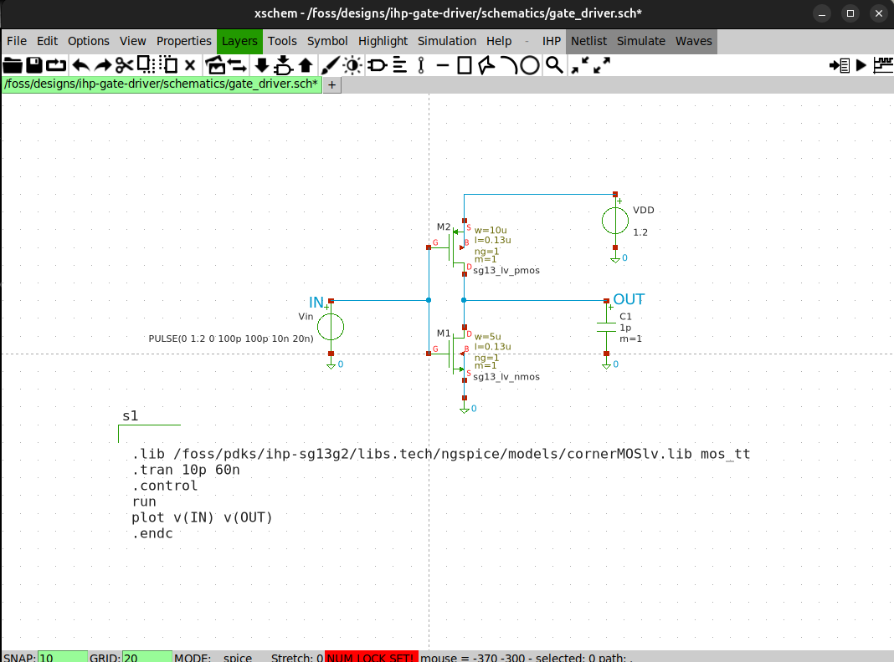
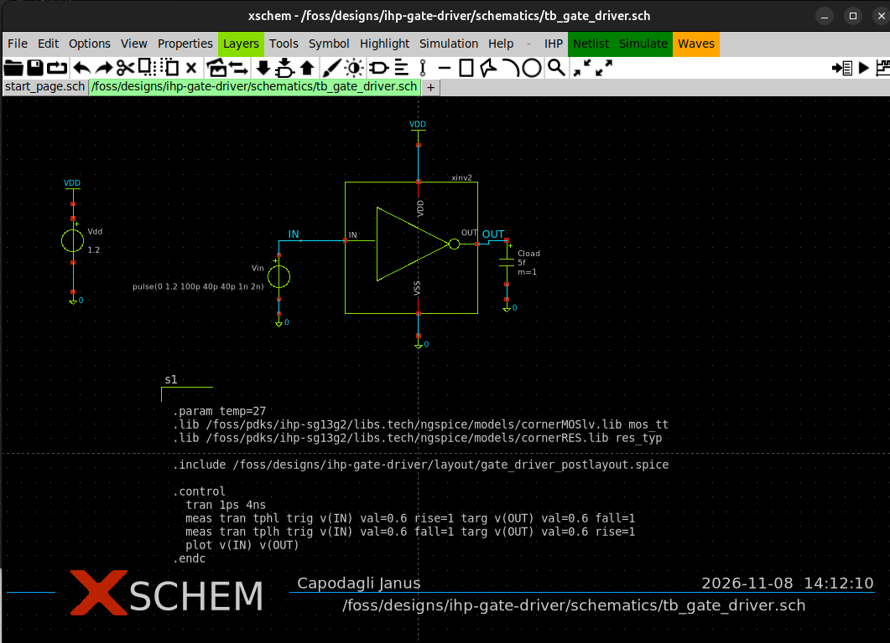

# Schematics & Simulation Testbenches

This folder contains the Xschem schematic definitions, component symbols, and Ngspice simulation setups for the IHP SG13G2 gate driver cell.

---

## Files in this Directory

| File | Description |
| :--- | :--- |
| `gate_driver.sch` | Primary inverter schematic ($W_n = 5\,\mu\text{m}$, $W_p = 10\,\mu\text{m}$, $L = 0.13\,\mu\text{m}$). |
| `xinv.sym` | Four-terminal hierarchical symbol (`VDD`, `OUT`, `IN`, `VSS`). |
| `tb_gate_driver.sch` | Complete transient simulation testbench with voltage sources and load configuration. |

---

## 1. Cell Schematic (`gate_driver.sch`)

The core cell uses standard low-voltage logic transistors from the SG13G2 PDK:
- **NMOS**: `sg13_lv_nmos` ($W = 5\,\mu\text{m}$, $L = 0.13\,\mu\text{m}$)
- **PMOS**: `sg13_lv_pmos` ($W = 10\,\mu\text{m}$, $L = 0.13\,\mu\text{m}$)
- Substrate taps: Dedicated `ptap1` and `ntap1` tie-downs ensure correct bulk biasing.

<p align="center">
  
</p>

---

## 2. Testbench Setup (`tb_gate_driver.sch`)

The testbench drives the inverter with a sharp step generator and evaluates propagation under variable capacitive loading ($C_{load} = 5\,\text{fF}$ to $30\,\text{fF}$).

<p align="center">
  
</p>

### SPICE Configuration Block
```spice
.param temp=27
.lib /foss/pdks/ihp-sg13g2/libs.tech/ngspice/models/cornerMOSlv.lib mos_tt
.lib /foss/pdks/ihp-sg13g2/libs.tech/ngspice/models/cornerRES.lib res_typ

.include /foss/designs/ihp-gate-driver/layout/gate_driver_postlayout.spice

.control
tran 1ps 4ns
meas tran tphl trig v(IN) val=0.6 rise=1 targ v(OUT) val=0.6 fall=1
meas tran tplh trig v(IN) val=0.6 fall=1 targ v(OUT) val=0.6 rise=1
plot v(IN) v(OUT)
.endc

```

---

## 3. Pre-Layout vs. Post-Layout Switching

To toggle between pre-layout schematic and post-layout PEX simulations:

1. Select the `xinv2` symbol in Xschem and press **`q`**.
2. **For Ideal Schematic simulation**:
```text
name=xinv2
format="@name @pinlist xinv"

```


3. **For Post-Layout PEX simulation**:
```text
name=xinv2
format="@name @pinlist xinv_pex"

```


